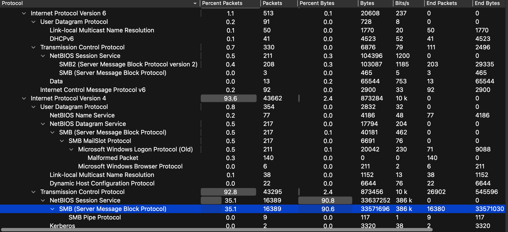
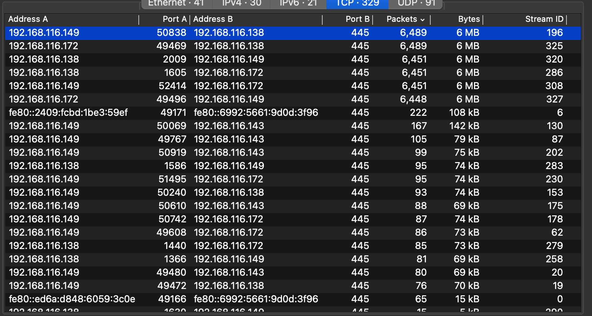
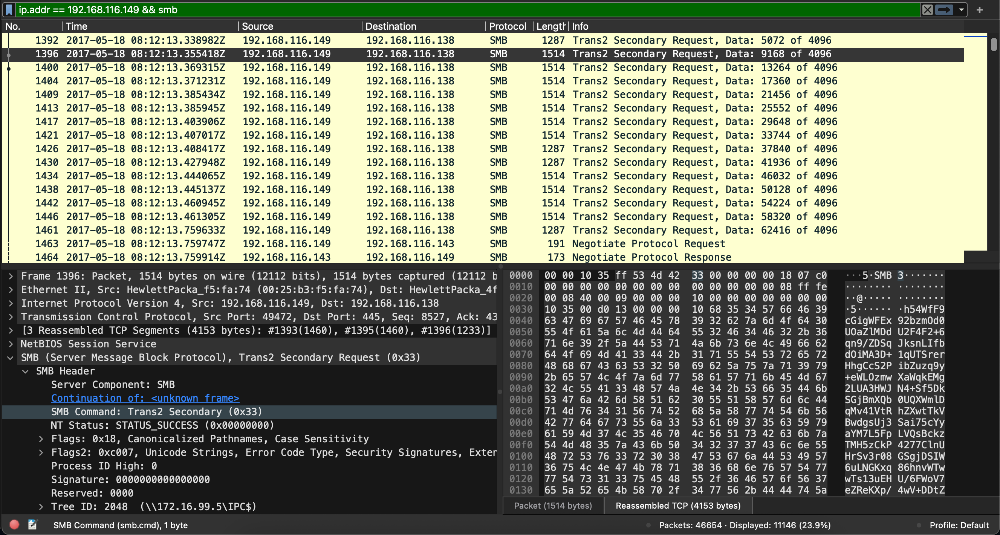
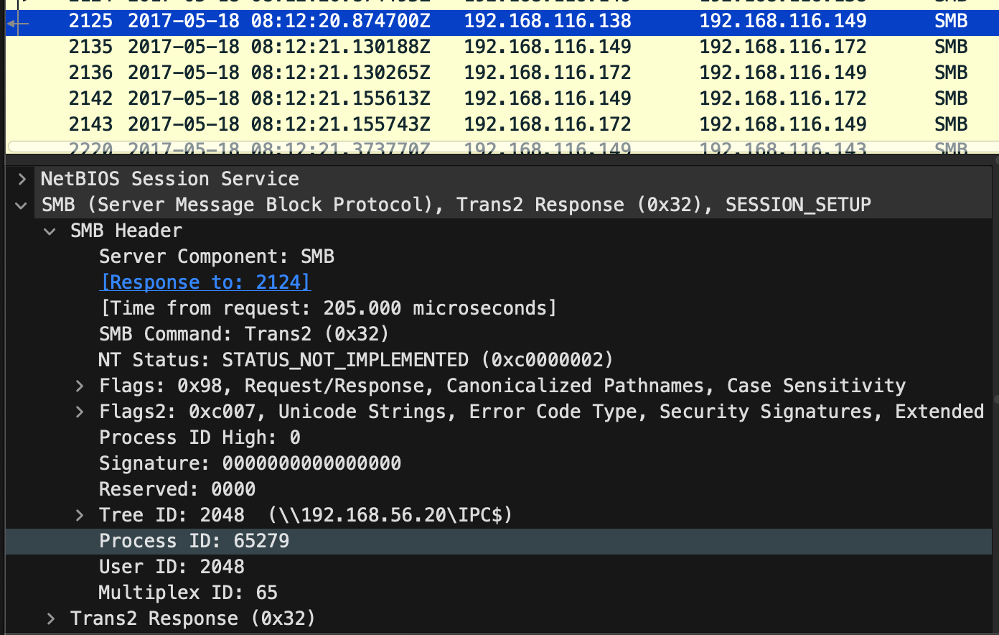
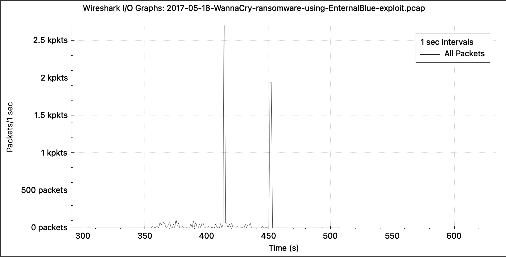
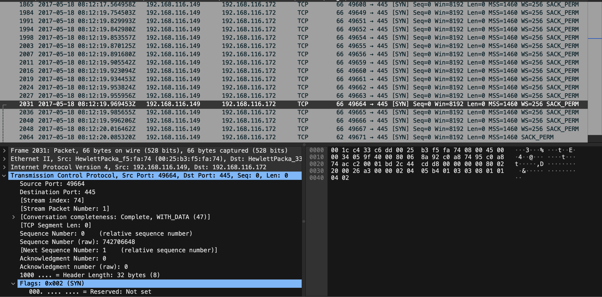

# WannaCry (WannaCrypt) — Threat Intelligence & Network Forensic Analysis

**Author:** Terran Rupchan  
**Date:** November 2026  
**Report Type:** Malware Threat Intelligence & Network Forensics

---

## 1. Executive Summary

WannaCry is a ransomware worm that operates through two main components, the first being the ransomware itself. Once executed on a compromised system, the payload encrypts files and demands a ransom payment in Bitcoin in exchange for promised decryption.

The second component is the worm. To spread to other systems, WannaCry uses an SMBv1 exploit known as **EternalBlue** to exploit vulnerable Windows systems remotely (Microsoft Defender Security Research Team, 2017).

Using a PCAP file, suspicious SMB traffic was investigated to identify potential malicious network activity. The findings suggest that the observed activity could be associated with WannaCry. Recommended defensive measures include restricting unnecessary SMB access, patching vulnerable systems, disabling unnecessary legacy protocols, and isolating systems suspected of compromise (Canadian Cyber Incident Response Centre, 2017).

## 2. Network Forensic Analysis

### 2.1 Dataset and Methodology

To investigate the attack, a PCAP file captured during activity associated with WannaCry was analyzed to better understand the network behaviour.

The dataset was obtained from Malware-Traffic-Analysis.net and was originally provided by cybersecurity researcher David Szili. The PCAP was generated in a controlled test environment where WannaCry was executed on a Windows 7 workstation and subsequently propagated to other Windows systems through the EternalBlue exploit (Szili, 2017).

Using Wireshark, the Protocol Hierarchy was examined, revealing that SMB accounted for a significant portion of the captured traffic, primarily communicating over TCP port 445.

*Figure 1. Wireshark Protocol Hierarchy displaying the distribution of network protocols within the WannaCry PCAP, including SMB traffic over TCP port 445.*

### 2.2 Host Identification

The conversations containing the highest packet counts were examined, and one IP address stood out due to its high volume of TCP traffic: `192.168.116.149`.

This host became the primary focus of the investigation, with additional filtering applied to examine packets associated with the IP address and TCP port 445.

According to the dataset documentation, this IP address belonged to a Windows 7 x86 workstation named `DFIR_Win7_x86`. The dataset author identified this machine as the system on which the WannaCry sample was initially executed during the controlled experiment (Szili, 2017).

*Figure 2. Wireshark IPv4 Conversations displaying network communication involving host 192.168.116.149, which was selected for further investigation due to its elevated TCP traffic.*

### 2.3 SMB Traffic Analysis

The host exhibited a high volume of SMB activity, including repeated Trans2 requests directed toward other IP addresses. Server responses included `STATUS_NOT_IMPLEMENTED` within the SMB header.

*Figure 3. Repeated SMB Trans2 requests observed during the network investigation, demonstrating suspicious SMB communication involving host 192.168.116.149.*

Further packet inspection identified a reported SMB data count of 4,096 bytes. A second packet was examined, and the reported data lengths were found to match.

*Figure 4. Detailed inspection of SMB packets showing protocol response information and fields associated with the suspicious network activity.*

These observations were considered relevant because WannaCry uses specially crafted SMB communication to exploit vulnerable Windows systems (Microsoft Defender Security Research Team, 2017).

However, the presence of Trans2 requests or matching data lengths does not independently confirm that an EternalBlue exploit was successfully executed.

### 2.4 Traffic Patterns and I/O Graphs

To identify potential spikes in network traffic associated with the host, an I/O graph was generated using Wireshark. The results revealed two concentrated bursts of packet activity.

*Figure 5. Wireshark I/O Graph illustrating two concentrated bursts of network traffic observed during the WannaCry packet capture investigation.*

Packets preceding the first major spike were examined, revealing frequent TCP packets with SYN, ACK, and PSH flags.

The concentrated traffic patterns warranted further investigation because WannaCry's worm component can generate repeated network connections while attempting to propagate between vulnerable systems (Center for Internet Security, 2017).

### 2.5 Findings and Limitations

Analysis of the network capture identified suspicious SMB activity involving `192.168.116.149`. The observed traffic included repeated SMB Trans2 requests, elevated communication over TCP port 445, and two concentrated bursts of network activity.

These findings could indicate activity associated with WannaCry, given its known exploitation of SMB vulnerabilities and its worm-like propagation capabilities (Microsoft Defender Security Research Team, 2017).

The original dataset documentation confirms that WannaCry was deliberately executed in the test environment and propagated to other Windows hosts (Szili, 2017). This provides important context for interpreting the captured network activity.

However, the packet observations made during this investigation do not independently confirm which individual packets successfully exploited CVE-2017-0144 or whether memory corruption occurred on any targeted system.

Additional evidence, such as endpoint logs, memory analysis, malware artifacts, and further inspection of the SMB packet contents, could strengthen the assessment of a successful compromise.

## 3. Threat Overview

### 3.1 Background and Discovery

WannaCry (WannaCrypt) is a form of malicious software that caused a major global outbreak in May 2017. WannaCry is a type of malware known as ransomware, which is used to encrypt files in order to demand a ransom payment with the promise of decrypting the files.

Ransomware is commonly distributed through phishing emails containing malicious links or attachments. However, the exact initial infection method responsible for the WannaCry outbreak was not conclusively established (Microsoft Defender Security Research Team, 2017).

Microsoft documented the outbreak on May 12, 2017, in a security blog post titled "WannaCrypt ransomware worm targets out-of-date systems."

WannaCry spread rapidly during the outbreak because it combined ransomware functionality with worm capabilities. A worm is a type of self-propagating malware that can spread between vulnerable systems.

This is particularly dangerous because it does not require a user to open a malicious attachment on every system. Instead, once a system is compromised, WannaCry can attempt to infect other vulnerable systems on the network (Microsoft Defender Security Research Team, 2017).

### 3.2 Threat Actor and Attribution

WannaCry has been attributed to the North Korean state-linked Lazarus Group. In May 2017, Neel Mehta, a Google security researcher, identified similarities in the code between WannaCry and earlier malware that had been associated with Lazarus Group.

Further analysis by cybersecurity researchers, including BAE Systems and Kaspersky, investigated these connections (Kaspersky Global Research and Analysis Team, 2017).

Using binary analysis, researchers compared a Lazarus-associated backdoor sample from 2015 with an early WannaCry sample from February 2017. Both malware samples contained overlapping code (Kaspersky Global Research and Analysis Team, 2017).

Although shared code can suggest a connection between malware families, it does not independently confirm that the same threat actor developed them. Shared code could be a result of reuse or shared development resources.

It can also be used as a deliberate attempt to mislead investigators and hide an attacker's identity, known as a false flag.

In December 2017, the United States government publicly attributed the WannaCry attack to North Korea. The announcement stated that the attribution followed an investigation involving government and private-sector partners. This attribution was consistent with earlier findings by cybersecurity researchers (The White House, 2017).

### 3.3 EternalBlue and Exploited Vulnerabilities

Server Message Block (SMB) is a network file-sharing protocol commonly used by Windows systems. SMB is used within a network to access files stored on a central server. It also supports shared printers and other network resources. This protocol commonly communicates through Transmission Control Protocol (TCP) on port 445.

SMBv1 was the first major version of SMB and is now considered a legacy protocol. SMBv1 is not installed by default on Windows 11. Later versions of this protocol, SMBv2 and SMBv3, introduced improvements in performance, efficiency, and security (Microsoft, n.d.).

EternalBlue is an exploit that targets vulnerabilities in the SMBv1 implementation on affected Windows systems, potentially allowing an attacker to execute code remotely.

CVE-2017-0144 is a remote code execution (RCE) vulnerability associated with EternalBlue. It involves improper handling of specially crafted SMB messages, which can result in memory corruption. Successful exploitation can allow an unauthenticated attacker to execute malicious code with kernel-level privileges on a vulnerable Windows system (Microsoft, 2017).

WannaCry uses EternalBlue to exploit vulnerable systems through SMB communication over TCP port 445. Once a system is compromised, WannaCry's worm component can automatically attempt to infect additional vulnerable systems without requiring user interaction (Center for Internet Security, 2017).

On March 14, 2017, Microsoft released security bulletin MS17-010, addressing several SMB vulnerabilities, including CVE-2017-0144.

Despite this security update being available nearly two months before the WannaCry outbreak on May 12, 2017, many organizations remained vulnerable because affected systems had not been patched (Microsoft, 2017; Microsoft Defender Security Research Team, 2017).

Several factors contributed to this exposure, including outdated operating systems, legacy software dependencies, and inadequate patch management practices.

Organizations that continued using vulnerable, unpatched SMBv1 implementations were susceptible to exploitation through EternalBlue. This outbreak demonstrated the importance of timely security updates, vulnerability management, and disabling unnecessary legacy protocols (Canadian Cyber Incident Response Centre, 2017).

During the PCAP investigation, repeated SMB Trans2 requests, significant TCP port 445 traffic involving `192.168.116.149`, and two concentrated bursts of packet activity were observed.

*Figure 6. TCP SYN packets from host 192.168.116.149 directed toward port 445 on other systems, indicating attempts to establish SMB connections. These packets alone do not confirm successful exploitation.*

When comparing these findings with the known behaviour of EternalBlue and WannaCry, the traffic patterns could indicate attempted exploitation of vulnerable SMB services.

Communication with multiple IP addresses within the network could also suggest worm-like propagation, as WannaCry attempts to identify and infect additional vulnerable systems.

However, the network evidence examined in this investigation alone does not confirm that CVE-2017-0144 was successfully exploited or that memory corruption occurred on any targeted system.

### 3.4 Global Impact

WannaCry had a significant global impact. As of May 15, 2017, the European Union Agency for Cybersecurity (ENISA) reported approximately 190,000 affected computers across more than 150 countries (ENISA, 2017).

Later estimates cited by Kaspersky placed the total at approximately 230,000 computers worldwide (Kaspersky, n.d.).

The outbreak disrupted organizations across multiple critical infrastructure sectors, including healthcare, transportation, energy, finance, and telecommunications (ENISA, 2017).

One of the major services affected was the United Kingdom's National Health Service (NHS). According to the National Audit Office, 45 NHS organizations were initially identified as affected, including 37 trusts infected by WannaCry. Further investigation revealed that at least 81 of the 236 NHS trusts in England experienced disruption (National Audit Office, 2017).

The attack resulted in thousands of cancelled appointments and operations. NHS England estimated that more than 19,000 appointments were cancelled. Patients were diverted to other healthcare facilities, and five emergency departments were unable to treat some patients (National Audit Office, 2017).

No NHS organization paid the ransom, but the attack resulted in significant operational disruption and recovery costs.

The outbreak was significantly slowed when a cybersecurity researcher discovered and activated a "kill switch" by registering a domain checked by the malware. This prevented the original WannaCry variant from continuing its malicious execution on additional systems that could reach the domain.

However, the kill switch did not restore systems that had already been encrypted, and it did not protect against all possible variants of WannaCry (Microsoft Defender Security Research Team, 2017; National Audit Office, 2017).

The WannaCry attack resulted in an estimated £92 million in financial costs for the NHS and approximately $4 billion USD in estimated losses worldwide, according to figures reported by Kaspersky (n.d.).

These figures represent estimated economic impacts rather than confirmed ransom payments. The financial damage extended far beyond the ransom payments themselves, as organizations experienced operational downtime, lost productivity, disrupted services, and significant costs associated with restoring affected systems.

The outbreak demonstrated how a single exploited vulnerability could cause widespread disruption across multiple industries and countries, emphasizing the importance of proactive cybersecurity measures and effective incident response.

## 4. References

Canadian Cyber Incident Response Centre. (2017, May 15). *Alert – Ransomware – WannaCry (AL17-006).* Canadian Centre for Cyber Security. https://www.cyber.gc.ca/en/alerts-advisories/ransomware-wannacry

Center for Internet Security. (2017, May 15). *Cyber alert: WannaCry ransomware.* https://www.cisecurity.org/ms-isac/cyber-alert-wannacry-ransomware

European Union Agency for Cybersecurity. (2017, May 15). *WannaCry ransomware: First ever case of cyber cooperation at EU level.* https://www.enisa.europa.eu/news/enisa-news/wannacry-ransomware-first-ever-case-of-cyber-cooperation-at-eu-level

Kaspersky. (n.d.). *What is WannaCry ransomware?* https://www.kaspersky.com/resource-center/threats/ransomware-wannacry

Kaspersky Global Research and Analysis Team. (2017, May 15). *WannaCry and Lazarus Group – The missing link?* Securelist. https://securelist.com/wannacry-and-lazarus-group-the-missing-link/78431/

Microsoft. (n.d.). *Detect, enable, and disable SMBv1, SMBv2, and SMBv3 in Windows and Windows Server.* Microsoft Learn. https://learn.microsoft.com/en-us/windows-server/storage/file-server/troubleshoot/detect-enable-and-disable-smbv1-v2-v3

Microsoft. (2017, March 14). *Microsoft Security Bulletin MS17-010 – Critical.* Microsoft Learn. https://learn.microsoft.com/en-us/security-updates/securitybulletins/2017/ms17-010

Microsoft Defender Security Research Team. (2017, May 12). *WannaCrypt ransomware worm targets out-of-date systems.* Microsoft Security Blog. https://www.microsoft.com/en-us/security/blog/2017/05/12/wannacrypt-ransomware-worm-targets-out-of-date-systems/

National Audit Office. (2017, October 27). *Investigation: WannaCry cyber attack and the NHS.* https://www.nao.org.uk/reports/investigation-wannacry-cyber-attack-and-the-nhs/

Szili, D. (2017, May 18). *PCAP of WannaCry spreading using EternalBlue* [Packet capture and guest blog]. Malware-Traffic-Analysis.net. https://malware-traffic-analysis.net/2017/05/18/index2.html

The White House. (2017, December 19). *Press briefing on the attribution of the WannaCry malware attack to North Korea.* https://trumpwhitehouse.archives.gov/briefings-statements/press-briefing-on-the-attribution-of-the-wannacry-malware-attack-to-north-korea-121917/